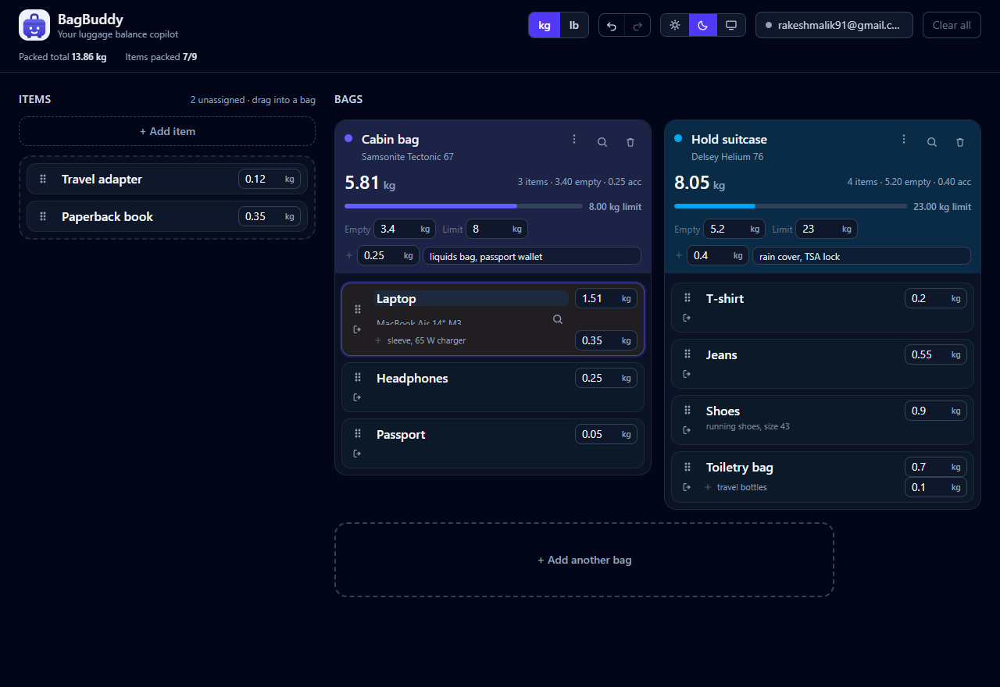

<div align="center">
  
  <h1>BagBuddy</h1>
  <p><strong>Your luggage balance copilot.</strong> Drag your things into your bags and see every bag's total weight.</p>
  <p>
    <a href="https://bag-buddy-f0896.web.app/">bag-buddy-f0896.web.app</a>
    &middot;
    <a href="https://bag-buddy-f0896.firebaseapp.com/">bag-buddy-f0896.firebaseapp.com</a>
    &middot;
    <a href="https://bag-buddy.netlify.app/">bag-buddy.netlify.app</a>
  </p>
</div>



## What it does

- **Any number of bags**, each with an empty weight, an optional limit and its own extras.
- **Any number of items**, each with a name, a weight and optional accessories.
- **Pouches**, items that hold other items: a packing cube or a toiletry bag counts once in the
  list and adds up its contents to the bag total.
- **Drag and drop** between the tray, the bags and any pouch, with keyboard and touch support.
- **Per-bag totals**, and a limit that warns as you approach it.
- **Bag and item extras** for the things that travel *with* them: a rain cover, a laptop
  sleeve, the charger in the box.
- **Product names** on everything, which is what weight lookup searches for.
- **kg or lb**, stored in kilograms so switching units never drifts.
- **Undo and redo**, light and dark themes, and one to three item columns per bag.
- **Optional cloud sync** to Firebase Storage, and `utils/sync.py` to back it up locally.

Weight is the only constraint for now. Dimensions are planned: [docs/roadmap.md](docs/roadmap.md).

## Layout

```text
webapp/    the React app: src, public, Vite, TypeScript, ESLint and deploy config
utils/     sync.py, the local backup tool, and dev-server.ps1, which run.bat drives
docs/      design notes
data/      board backups written by sync.py, not in the repository
```

## Running it

```bat
run.bat              :: installs if needed, then starts the dev server
run_all_tests.bat    :: type check, lint, production build
```

Both run from `webapp/`. To drive the tools directly, `cd webapp` first.
`run.bat` ties the dev server to its own window, so closing the terminal stops the
server instead of leaving it running in the background. `run.bat 5174` starts it on
another port.

## Weight lookup

Tap the magnifier on any item or bag. Three sources, no key needed for the first two:

| Source | Needs a key | Returns |
| --- | --- | --- |
| Offline typical weights | no | Built-in table of typical packed weights |
| Open Food Facts | no | Real product data, strong for groceries |
| OpenRouter | your own | A model's estimate, which is a guess |

Details and the production path: [docs/weight-lookup.md](docs/weight-lookup.md).

## Backups

```bat
sync.bat              :: or: python utils\sync.py
```

Pulls the saved boards into `data/` as readable JSON, limited to the two allowlisted
accounts. Extra arguments are passed straight through, so `sync.bat --email a@b.c` works.
See [docs/cloud-sync.md](docs/cloud-sync.md).

## Deploying

The live Firebase URLs are [bag-buddy-f0896.web.app](https://bag-buddy-f0896.web.app/) and
[bag-buddy-f0896.firebaseapp.com](https://bag-buddy-f0896.firebaseapp.com/), both serving the
same site.

`.github/workflows/deploy.yml` publishes `webapp/dist` to Firebase Hosting on every push to
`main`. It installs with `npm ci`, runs the type check, lint and build, then deploys, so a
commit that breaks a check never reaches the live site. It authenticates with Workload Identity
Federation, which needs two repository secrets and no key file:

| Secret | Value |
| --- | --- |
| `WIF_PROVIDER` | The full provider resource name from Workload Identity |
| `WIF_SERVICE_ACCOUNT` | The email of the service account GitHub deploys as |

The service account needs `roles/firebasehosting.admin` and `roles/serviceusage.serviceUsageConsumer`
on `bag-buddy-f0896`. `docs/deploy.md` has the one-time setup.

By hand, the same deploy is `npm run build` then `firebase deploy --only hosting` from `webapp/`,
which reads `webapp/firebase.json`. That form also needs `firebase login` on the machine.
`--only hosting` keeps a deploy to the site; storage rules are separate, via
`firebase deploy --only storage`.

`netlify.toml` at the repository root sets the base directory to `webapp/`, so Netlify installs
`webapp/package-lock.json`, runs `npm run build` there and publishes `webapp/dist`.

## Notes

No analytics, no cookies. Bags live in `localStorage` first; signing in copies them to your
own folder in the bucket under `<email>/state.json`. Any API key you type stays in the
browser and is sent only to that provider.

## About

© Rakesh Malik 2026
Co authored by: Spaace Bunny Alpha

[CC0 1.0 Universal](LICENSE).
